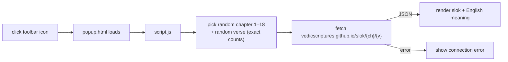

# Gitanest

> A Manifest V3 browser extension that shows a random Bhagavad Gita verse — chapter, verse number, and English meaning — every time you click it.

[](LICENSE)
[](https://github.com/chirag127/Gitanest/stargazers)
[](https://github.com/chirag127/Gitanest/commits)
[](https://developer.chrome.com/docs/extensions/mv3/intro/)

**GHP landing** https://chirag127.github.io/Gitanest/ · **Repo** https://github.com/chirag127/Gitanest

⭐ If this is useful, please star the repo — it helps others find it.

Gitanest is a tiny, dependency-free MV3 extension. Click its toolbar icon and the popup picks a random chapter (1–18) and a random verse within that chapter, fetches it from the public [vedicscriptures.github.io](https://vedicscriptures.github.io) API, and renders the Sanskrit `slok` alongside its English meaning. No build step, no tracking, no data stored.

## How it works



The verse counts per chapter are hard-coded, so every random pick maps to a real verse. The extension only needs network access to the verse API (declared as `host_permissions`).

## Features

- Random Bhagavad Gita verse on every click, across all 18 chapters with correct per-chapter verse counts.
- Shows chapter, verse number, the Sanskrit `slok`, and its English meaning.
- Graceful error message if the verse API can't be reached.
- Zero dependencies, zero build, no analytics, no stored data.

## Tech stack

- **Manifest V3** browser extension (Chrome / Edge / Chromium).
- Vanilla HTML, CSS, and JavaScript (`fetch`).
- Public data source: the [vedicscriptures](https://vedicscriptures.github.io) verse API.

## Repo structure

```
Gitanest/
├── manifest.json    # MV3 manifest — action popup, icon, host_permissions for the verse API
├── popup.html       # popup markup (verse + meaning placeholders)
├── style.css        # popup styling
├── script.js        # pick a random verse, fetch it, render or show an error
└── logo.png         # 128px extension icon
```

## Install (load unpacked)

1. Download or clone this repo.
2. Open `chrome://extensions` (or `edge://extensions`).
3. Enable **Developer mode**.
4. Click **Load unpacked** and select the repo folder.
5. Pin the extension, then click its icon to get a verse.

No build or bundling is required — it is a static extension.

## Configuration

None. There are no environment variables or settings; the extension fetches from a fixed public API.

## Part of the oriz family

One of ~80 sites and tools in the oriz family. See [blog.oriz.in](https://blog.oriz.in).

## Contributing

Issues and PRs welcome. Keep it minimal and dependency-free.

## Status

Complete and stable (v1.0.0).

## License

MIT © Chirag Singhal — chirag@oriz.in

Conventional commits are the changelog.
